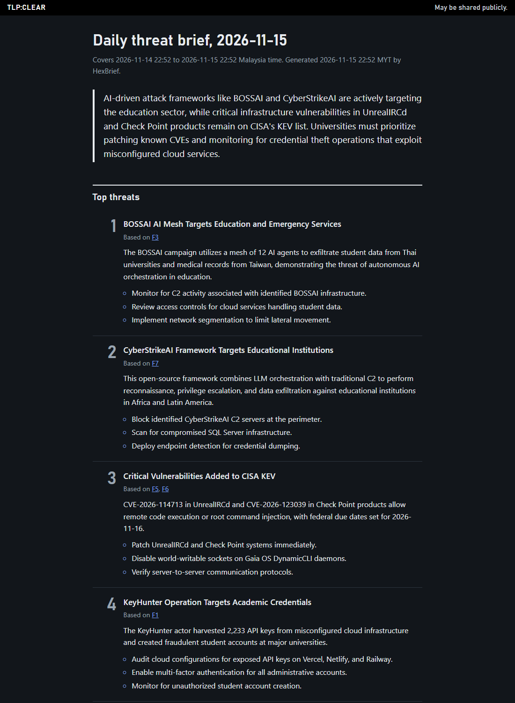
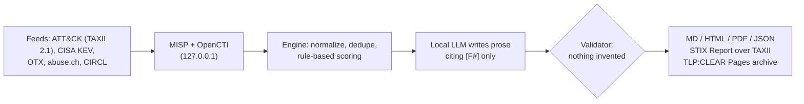

# HexBrief

> A self-updating threat-intel brief: public feeds in over STIX/TAXII, correlated in MISP and OpenCTI, written up each morning by a **local** LLM, and fact-checked so it never invents an indicator.

[](https://github.com/mechanicb0y/hexbrief/actions/workflows/ci.yml)
**Live archive:** [mechanicb0y.github.io/hexbrief](https://mechanicb0y.github.io/hexbrief/) · **Sample brief:** [docs/sample-brief.md](docs/sample-brief.md)

[](https://mechanicb0y.github.io/hexbrief/)

## How it works



1. Free feeds flow into MISP and OpenCTI and are stored as a STIX 2.1 knowledge graph.
2. Every day at 07:00 MYT the engine reads the last 24 hours, merges stories that share CVEs or IOCs, and ranks them with written rules (CISA KEV, exploitation, recency, corroboration, and relevance to education/Malaysia/ASEAN).
3. A local model writes the narrative about the top 8 and cites them by ID.
4. A validator rejects any IP, domain, URL, hash, CVE or ATT&CK ID that isn't in the data. Unchecked text is never published.
5. The brief ships as Markdown, HTML, PDF, JSON and a STIX 2.1 Report over TAXII 2.1, and TLP:CLEAR briefs go to the public archive.

Full diagram and component map: [docs/architecture.md](docs/architecture.md).

## Quickstart

**Demo, in under 10 minutes: no keys, no Docker, no MISP/OpenCTI.** It builds a full brief from recorded TLP:CLEAR data, and the recorded narrative passes the same validation gate.

```powershell
git clone https://github.com/mechanicb0y/hexbrief; cd hexbrief
python -m venv .venv; .venv\Scripts\activate      # Python 3.12+
pip install .
hexbrief demo                  # → out\demo\brief.{md,html,json,stix.json}
hexbrief demo --llm --pdf      # optional: write the narrative live with Ollama, export PDF
```

**Full stack** (Windows + Docker Desktop + Ollama; see [docs/OPERATIONS.md](docs/OPERATIONS.md)):

```powershell
pip install -e ".[dev]"; copy .env.example .env   # add your free OTX + abuse.ch keys
scripts\gen-secrets.ps1
scripts\opencti-up.ps1; python scripts\opencti_setup.py
python scripts\abusech_import.py
hexbrief doctor
hexbrief run --push --pages    # today's brief, pushed to OpenCTI/TAXII and the archive
scripts\install-schedule.ps1   # daily at 07:00 MYT
```

## STIX/TAXII in and out

- **In:** MITRE ATT&CK over TAXII 2.1, through OpenCTI's connector and HexBrief's own TAXII 2.1 client (`stixkit/taxii.py`: pagination, `added_after`, retries, typed errors, no credentials in logs). The OpenCTI TAXII2 connector also pulls from the lab TAXII server.
- **Out:** each brief is a validated STIX 2.1 `report` (`threat-report`, `object_refs` to the underlying objects, official TLP 2.0 marking, deterministic id per day). It is pushed into OpenCTI, whose TAXII 2.1 collection **`daily-briefs`** serves it, and into a pinned medallion server.
- Toolkit: `hexbrief taxii collections|count|push`, `hexbrief stix demo-bundle` ([ADR-002](docs/adr/002-taxii-tooling.md)).

## How the brief stays truthful

- Facts come from data; the model only writes prose. Tables, KEV list, ATT&CK techniques and the IOC appendix are rendered from data, never typed by the model.
- Local `qwen3.5:4b` via Ollama with JSON-schema structured output and temperature 0.1 ([ADR-005](docs/adr/005-llm-model.md), [benchmark](docs/benchmarks/llm-2026-11-15.md)).
- **Hard gate:** `hexbrief.validate` refangs the text and checks every IPv4/IPv6, domain, URL, MD5–SHA-512 hash, CVE and ATT&CK ID against the input. Tests plant fakes, including defang and case tricks found in security review.
- A **completeness** check catches omissions the faithfulness check can't see.
- Retries feed back the errors and the rejected answer, then the fallback model is tried, then a **facts-only** brief is published.

## Security and ethics

- Every service binds to `127.0.0.1`; only the GitHub Pages archive is public.
- **TLP 2.0** on every finding, and unmarked data counts as AMBER. Only TLP:CLEAR is published, guarded in code and again in CI.
- Indicators are text only: never visited, resolved or downloaded. They are defanged everywhere humans read (including IPs inside URL paths).
- Intel goes only to a local LLM, never to a cloud AI API.
- Least privilege: read-only MISP/OpenCTI users for the engine, and a confidence-capped importer.
- Secrets live in git-ignored env files and are generated by script. gitleaks runs in pre-commit and CI, alongside bandit, pip-audit, SHA-pinned actions and Dependabot.

## Components

| | |
|---|---|
| MISP 2.5 (on demand, 127.0.0.1:8443, lab CA) | `scripts\misp-up.ps1`, `hexbrief misp recent\|stix\|snapshot` ([ADR-003](docs/adr/003-misp-deployment.md)) |
| OpenCTI 7 (127.0.0.1:8088) | `scripts\opencti-up.ps1`, `hexbrief opencti recent` ([ADR-004](docs/adr/004-opencti-deployment.md)) |
| Brief engine | `hexbrief run`, `hexbrief republish <day>` |
| Operations | `scripts\daily.ps1`, `hexbrief doctor`, `scripts\backup.ps1` ([ADR-006](docs/adr/006-automation.md), [runbook](docs/OPERATIONS.md)) |

## Design decisions

[ADR-001 hardware path](docs/adr/001-hardware-path.md) · [ADR-002 TAXII tooling](docs/adr/002-taxii-tooling.md) · [ADR-003 MISP](docs/adr/003-misp-deployment.md) · [ADR-004 OpenCTI](docs/adr/004-opencti-deployment.md) · [ADR-005 local LLM](docs/adr/005-llm-model.md) · [ADR-006 automation & CI](docs/adr/006-automation.md)

Write-up: [How I built a self-updating threat intel brief](docs/launch/writeup.md) · [Changelog](CHANGELOG.md)

## Roadmap

ATT&CK Navigator layer weekly · cloud-lite mode in Actions (KEV + abuse.ch + ATT&CK) · blocklist export for my StockFW firewall · sightings from a home lab · a PIR file that drives scoring.

## Skills demonstrated

STIX 2.1 / TAXII 2.1 (client and server), MISP and OpenCTI deployment and APIs, TLP 2.0 handling, threat-intel scoring and the intelligence lifecycle, safe local-LLM use with a faithfulness gate, typed Python (httpx, Typer, Jinja2, pytest), Docker Compose hardening, Windows automation, CI/CD and supply-chain hygiene.

## License

[Apache-2.0](LICENSE). Feed data belongs to its sources (MITRE ATT&CK, CISA, AlienVault OTX, abuse.ch, CIRCL) under their terms.
