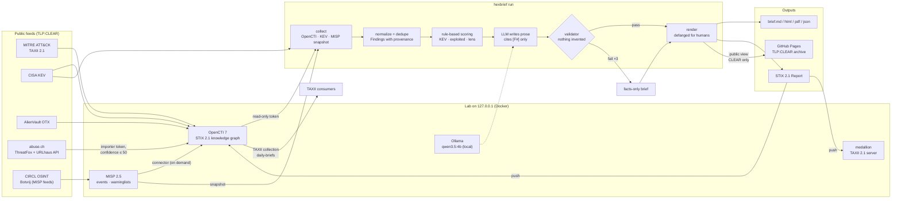

# Architecture

## In words

1. Feeds flow into MISP (CIRCL OSINT, Botvrij) and OpenCTI (MITRE ATT&CK over TAXII 2.1, CISA KEV, AlienVault OTX, and abuse.ch via HexBrief's own API importer).
2. At 07:00 MYT, `scripts/daily.ps1` runs MISP alone and snapshots its fresh findings, then OpenCTI, then `hexbrief run`. The two never run at the same time, because they don't fit in RAM together.
3. The engine normalizes everything into findings that keep their sources, deduplicates them on shared CVEs and IOCs, and ranks them with written rules.
4. The top 8 go to a **local** model, which writes prose that cites `[F#]`. A validator rejects any IP, domain, URL, hash, CVE or ATT&CK ID that isn't in the data. After 3 failed tries the brief is published facts-only.
5. Humans get defanged Markdown, HTML and PDF. Machines get JSON and a STIX 2.1 Report, which is pushed to OpenCTI (served over TAXII as `daily-briefs`) and to medallion. The TLP:CLEAR public view goes to GitHub Pages.
6. Every service binds to 127.0.0.1. Only the Pages site is public.

| Component | Where | ADR |
|---|---|---|
| Hardware path, lab sizing | `.wslconfig`, compose limits | [001](adr/001-hardware-path.md) |
| TAXII client + medallion | `src/hexbrief/stixkit/`, `docker/taxii/` | [002](adr/002-taxii-tooling.md) |
| MISP | `docker/misp/`, `collectors/misp.py` | [003](adr/003-misp-deployment.md) |
| OpenCTI + connectors | `docker/opencti/`, `collectors/opencti.py` | [004](adr/004-opencti-deployment.md) |
| Local LLM | `src/hexbrief/llm/`, `validate.py` | [005](adr/005-llm-model.md) |
| Automation, CI | `scripts/daily.ps1`, `.github/workflows/` | [006](adr/006-automation.md) |
